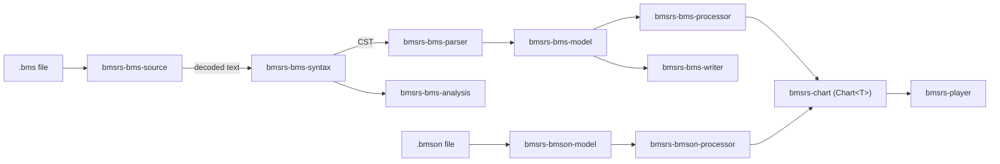

# bmsrs

## Project scope

A Rust workspace for parsing, converting, and simulating playback of BMS
(Be-Music Script) and BMSON chart formats. It produces a unified `Chart<T>`
intermediate representation for renderers and players.

> **Release status**: `0.0.3` is released; the project is pre-1.0. All public
> interfaces may change at any time and semver compatibility does not apply.
> Cross-crate architectural changes and breaking API changes only require
> confirmation from the user.

## Pipeline

## Crate responsibility matrix

| Crate | Role | Input to output |
|-------|------|-----------------|
| `bmsrs-bms-source` | source-text layer | `Vec<u8>` to `Document` |
| `bmsrs-bms-syntax` | syntax layer (rowan CST) | `&str` to `SourceFile` |
| `bmsrs-bms-values` | single-line typed values | `&str` (one line) to typed values |
| `bmsrs-bms-model` | whole-file `Bms` model | token stream to `Bms` |
| `bmsrs-bms-parser` | BMS semantic layer: CST to `Bms` model | CST to `Bms` |
| `bmsrs-bms-values-derive` | `#[derive(BmsTokenAttr)]` proc-macro | no runtime logic |
| `bmsrs-bms-processor` | `Bms` to format-agnostic `Chart` | `Bms` to `Chart` |
| `bmsrs-bms-writer` | BMS generator: rewrites the full `Bms` model as BMS text | `Bms` to `String` |
| `bmsrs-bms-analysis` | analysis layer (diagnostics, symbols) | `&str` to `Analysis` |
| `bmsrs-bmson-model` | bmson JSON type definitions (v0/v1/v2) | data model only |
| `bmsrs-bmson-processor` | `Bmson` to `Chart` | `Bmson` to `Chart` |
| `bmsrs-chart` | Format-agnostic chart data model | `Chart<T>` as the central IR |
| `bmsrs-player` | Pure simulation layer for `Chart<T>` | timeline queries, no I/O or rendering |
| `bmsrs-pipeline` | Shared pipeline result and diagnostic types | `Outcome<T, W>` and `Diagnostic` |
| `bmsrs` | Public re-export facade | aggregated `pub use` |

`bms-lsp` lives in a separate repository: <https://github.com/brightmeows/bms-lsp>.
It depends on this repository's `bmsrs-bms-analysis` and `bmsrs-bms-syntax`
through a git
`rev` and is no longer built as part of this workspace.

External dependencies are managed through `[workspace.dependencies]`; do not
specify versions in individual crate `Cargo.toml` files.
Internal dev-dependencies are the one exception: declare them path-only
(`{ path = "..." }`, no version) so cargo drops them from published manifests.
A version requirement there forces `cargo publish` to resolve the dependency
from the registry, and release-plz orders releases without dev-dependencies,
so packaging fails whenever the dependency crate has not been published yet.

### Facade crate

The repository root is the `bmsrs` facade crate. When adding a workspace crate,
add the corresponding `pub mod` and `pub use` in `src/lib.rs`.

## Commands

Every change passes `pre-commit run --all-files`; the hook list and each
failure's fix live in `.pre-commit-config.yaml`. Workspace tests run with
`cargo test --workspace --quiet`, hot-path benchmarks with
`cargo bench -p bmsrs-player`, and the dependency audit with
`cargo deny check` (CI).

## Conventions

### Commit format

Conventional Commits, matching the `release-plz.toml` changelog groups.
Titles and bodies are written in English. This is a repository-level override
of the global convention, which uses Chinese commit subjects.
Mark breaking changes with `!` before the colon.
Breaking-change commits must also carry a
`BREAKING CHANGE: <migration note>` footer with a single-line migration note;
the release-plz changelog template renders it into the changelog entry.

### Worktree directory

Git worktrees live under `.worktrees/`.

### Lint conventions

- The workspace uses a shared `[lints]` configuration: `allow_attributes = "deny"`
- `#[allow]` is **forbidden**; always use `#[expect(clippy::lint, reason = "...")]`
- The full lint table lives in `[workspace.lints]` in the root `Cargo.toml`

### API design

Namespace a public operation on the type it belongs to: constructors, queries,
conversions, and lifecycle stages are associated functions. An operation stays
free in three cases: it has no domain type to hang on (`base36_digit_value`),
its natural owner cannot host it because of the dependency direction
(`Bms::parse` would make the model crate depend on the parser), or the language
requires it, as with a `#[proc_macro_derive]` entry point.

The rule buys discoverability: every operation appears in its type's rustdoc,
and a call site names what it acts on. It costs a divergence from Rust's
free-function idiom; rust-analyzer's guide takes the opposite default for
single-action APIs, so read this as this workspace's convention, not as a
correctness rule.

The facade may flatten an associated function into a free entry point when the
body is a single delegation to it and the receiver would be the only argument
(`bms::write` is `BmsWriter::write`). The condition is that no second
implementation exists to keep in sync.

A zero-sized namespace type (`BmsProcessor`, `BmsonProcessor`, `BmsWriter`)
groups operations that share a parameter set or a conversion process; it is not
a builder. Builder means a type with a terminal method that consumes it, and
`MessagesBuilder` is the only one in the workspace.

Private operations follow the same criterion. The rule is about where the name
lives, not about who may call it.

Diagnostic codes come from `bmsrs_pipeline::DiagnosticCode` only. A layer may
wrap it in its own warning type, but no layer may invent a second string
vocabulary; `DiagnosticCode::as_str` is the only place a code becomes a string.

### Interface shapes

Pick the construction shape by what varies, not by habit:

| What varies | Shape | Example |
|-------------|-------|---------|
| Required inputs only | constructor | `Chart::new`, `TimingTrack::new` |
| Optional overlays on a one-shot value | consuming `with_*` setter | `ChartData::new(..).with_ln_type_hint(..)`, `Diagnostic::new(..).with_span(..)` |
| Configuration reused across calls | options struct with public fields | `ParseOptions`, `DocumentOptions` |
| A stage the caller must not skip | consuming finalizer | `MessagesBuilder::finish` |
| Optional overlays that repeat as a set | preset `for_*` constructor | none yet; the trigger is a second call site setting the same seven `ChartData` overlays |

An options struct implements `Default` only when the default is specified
behavior (first branch, `CollectAll`), not an arbitrary guess; a caller with a
better default should have to say so.

A builder type is not the default shape. The pipeline is a pure data
transformation, so a separate builder adds a type, a fallible `build()`, and a
second spelling of the same arguments without removing anything a constructor
plus `with_*` already removes. Reassess only when construction gains staged
requirements or mutually exclusive choices, which is where typestate pays for
itself.

Every type named by a curated facade entry point must resolve from the same
module. `tests/facade_api.rs` names them, so dropping a re-export fails to
compile. `raw` is the escape hatch for everything else, which means `prelude`
imports from the curated modules and never from `raw`.

`pub` inside a private module is the house style: `clippy::redundant_pub_crate`
is denied, and the private module already caps visibility. The compiler's
`unreachable_pub` lint stays off because the two contradict each other. The
over-wide items already in the tree are not chased; the lint conflict is the
reason, and `pub(crate)` would fail the build.

Enums mirroring a closed external vocabulary (BMS channels, syntax kinds,
header commands) stay exhaustive, including `EventKind`: a new event kind means
the format gained a construct, and every renderer should be forced to handle it
rather than silently ignore it.

Deferred interface work, with the trigger that reopens it:

| Item | What deferring costs today | Trigger |
|------|---------------------------|---------|
| Input sum type (`Text` / `Bytes` / `File` / recorded selection) replacing the eight `bms::parse*` entry points | `parse_bytes` assumes `SourceFormat::Bms`, so `.bmd` bytes miss the `;` comment rule, Base62 normalization, and synth `#WAV` that `parse_file` applies | a third consumer needs the entry points, or a new input axis arrives |
| One `parse` spelling across `bms` and `bmson` | the prelude exports the BMS `parse` only; BMSON callers spell the full path, which is why `bmson::process_nkeys` is in the prelude and `bmson::process` is not | the input sum type lands |
| `Viewport` options struct | `Viewport::new` takes two `f64`, so a swapped pair compiles | a third display parameter arrives; `Viewport::new` already clamps both scalars, so a new field would grow a `new_with_*` ladder |
| A recoverable-warning channel for `bmson::parse_str` | a tool handling both formats branches on the return shape, since `bms::parse` returns `Outcome` and `bmson::parse_str` does not | BMSON parsing produces its first recoverable warning |
| One return shape for range queries (`Player::events_in_range` yields a slice, `notes_in_range` an iterator) | one loop must call `.iter()` on one query and not the other | a consumer ranges over both in the same loop and has to convert |
| `#[non_exhaustive]` on `DiagnosticCode`, `SourceFormat`, and `SymbolKind` | every added variant breaks a downstream exhaustive match; free before 1.0 | 1.0, where semver starts to matter |

### Format sources

The format documents are external; the repository does not vendor them. Cite
the original sources, not intermediate notes.

| Area | Source |
|------|--------|
| BMS commands and channels | <https://hitkey.nekokan.dyndns.info/cmdsJP.htm> |
| BMSON schemas | <https://bmson-spec.readthedocs.io/> and <https://github.com/bmson/bmson> |
| beatoraja extensions | <https://github.com/exch-bms2/beatoraja> |
| KaleidBeat dialect | <https://github.com/curecoma/KaleidBeat-releases>; the manual is `KaleidBeat/documents/format-header.html`, `format-channel.html`, and `format-bmd.html` inside the release archive |
| KaleidBeat secondary contract | <https://github.com/hyrorre/bmz-player/blob/main/docs/kaleid.md> |

The KaleidBeat manual wins when the secondary contract disagrees.

### Development references

The following skill is maintained outside this repository.

| Skill | Source repository | Purpose |
|-------|-------------------|---------|
| `rust-meta-cognition` | <https://github.com/brightmeows/rust-meta-skills> | routing for Rust design and compilation problems |

### Comment style

- Public items use `///`; modules use `//!` (enforced by clippy)
- `//` is for implementation notes, not documentation
- Doc comments (`///`, `//!`) and implementation comments (`//`) are written in
  English; BMS/bmson commands and fields keep their canonical names, and code
  identifiers stay in backticks
- The `no-cjk-in-comments` hook enforces this for full-line `//` and
  `/* ... */` comments and `#[expect(..., reason = "...")]` strings (plain or
  raw); inline trailing comments and test assertion messages are covered by
  review
- Standard rustdoc section headings (`# Errors`, `# Panics`, `# Examples`, etc.)
  remain in English

### Test conventions

| Aspect | Rule |
|--------|------|
| Naming | `<scenario>_<expectation>`, e.g. `empty_input_returns_empty_bms` |
| Assertions | one test per scenario, possibly with multiple related assertions; the test name states the scenario and the expectation |
| Public API tests | live in `tests/*.rs` (integration tests); **do not** test public API inside `src/` |
| `pub(crate)` and private tests | live in `#[cfg(test)] mod` blocks inside `src/*.rs` |
| Prefer public types | avoid testing internal `Wrap` structs |
| Avoid duplication | before adding a test, check the crate's `tests/` and the `#[cfg(test)] mod` blocks in `src/`; add a new test only when existing tests cannot cover the scenario |

### Known limitations

These are boundaries intentionally left unimplemented or not yet closed.
Reassess them before adding support; do not assume silently.

| Item | Status | Reassess when |
|------|--------|---------------|
| Display fields such as `#CHARFILE` | not included in `Chart` | a renderer needs character images |
| `#CDDA` / `#MIDIFILE` | only stored in the `BmsAudio` sidecar; no playback abstraction | a player needs CD or MIDI sources |
| BMS `#BPM 0` | returns `ZeroBpm` instead of falling back to 130; mainstream engines (beatoraja) also fail to load such charts | charts with no scrolling need to be supported |
| Negative BPM | changes are dropped with a warning; a negative initial BPM is rejected; time flowing backwards (a negative BPM segment) is not modeled. Negative SCROLL rates, which reverse the visual scrolling only, are supported. bmz-player models the segment and reflects the judgment clock around the latest negative event (`reflect_time` over `TimeUs(i64)` plus recorded reflection points); adopting it requires a signed time domain | negative-BPM charts need support |
| KaleidBeat `free_zone_channels` (bmson) | typed into `BmsonKaleid` and exposed through `BmsonProcessed`; BMS text uses `BmsChannel::Extension` and `Processed.kaleid`. Free-zone judgment semantics stay in the player | a player needs the shared free-zone evaluation model |
| KaleidBeat conditional branches | structure, conditions, and branch rows are preserved in `Bms.conditional` and `Processed.kaleid`; condition evaluation, DEFAULT-based scoring, and branch replay stay in the player | a player needs the shared evaluation model |
| BMD synthesis audio | synthetic `AudioAsset.path` values (`bmd:<wav-id>`) and `BmsKaleid.synth`; a player without the sidecar sees them as missing files. The processor never probes these paths | a generic player needs a first-class synth source |
| BMSON MSS | `Long + Release` is exposed as a descriptive note point; no dedicated MSS judgment state | a player implements MSS scoring/input |
| BMSON layer-event `condition`/`interval`/`id_set` | clip selection conditions are not modeled; `bga_sequence` clips and clip references (poor/layer) are modeled, and bmson poor animations play the referenced clip | an imported chart needs condition-driven clip selection |
| BMS `#PLAYER` | ignored; `Bme` covers 5K/7K/10K/14K | automatic family selection by `#PLAYER` is needed |
| BGM layering | BGM events stay separate; only judgeable notes merge `NoteAudio`; beatoraja (`bgnotes`) and bmz-player (`bgm_events`) keep them separate as well | a real chart needs BGM layers merged |
| Precision of processor warnings | line-level `SourceSpan`; the exact note/cell is not stored; jbms-parser logs are line-based and bmz-player warnings carry keys but no cells, so this matches both reference engines | the editor needs cell-level warning highlighting |

### Cross-engine divergences

Where engines disagree, the default follows the specification and an opt-in
switch (or a documented refusal) covers the compatibility case. Do not "fix"
one side silently.

| Case | bmsrs default | Other engine | Where |
|------|---------------|--------------|-------|
| `#RANDOM 0` / `#SWITCH 0` | no branch matches; no value is drawn | jbms-parser / beatoraja clamp to `1` and draw once; LR2's `GetRand(-1)` consumes a word and selects `1` | `ControlFlowCompat::Jbms`; LR2 via `Lr2Mt19937` |
| `#ELSE` / `#ELSEIF` | a real fallback branch | jbms-parser only reserves RANDOM / IF / ENDIF / ENDRANDOM: the directive line is ignored, so every following body stays under the preceding `#IF` condition | `ControlFlowCompat::Jbms` |
| bmson `info.total` | `ChartInfo.total_percent` keeps the raw percentage; `ChartInfo.total` stays `None` | bmz-player converts it to a concrete gauge total against beatoraja's note-count formula | `total_percent` |
| Invalid BPM change | dropped with a warning (beatoraja behavior) | bmz-player clamps to `1.0`; bmsrs deliberately does not follow | processor warning |
| `#STOP` negative values | clamped to `0` and skipped | jbms-parser takes the absolute value; deliberately not followed | processor warning |
| `#LNTYPE 2` | MGQ-style pairing on channels 51-69, per the BMS specification | KaleidBeat's manual defines it as LNOBJ-terminated long notes | documented only; the standard reading stays |

### Versioning

- release-plz CI manages versions, CHANGELOG.md, and git tags
- Do **not** manually edit version numbers, create changelogs, or create tags

## Always / Ask / Never

### Always

- Run `pre-commit run --all-files` after changes (or let the hooks run automatically)
- Open a pull request once its checks pass; before merging, present the planned scope, a diff summary, and the check results, then wait for explicit approval
- Commit messages follow Conventional Commits with a scope; titles and bodies are written in English
- Each commit contains exactly one logical change; do not mix `feat:` and `fix:` in the same commit
- Doc comments (`///`, `//!`) and implementation comments (`//`) are written in English; code identifiers stay in backticks
- When adding a crate, add the corresponding `pub use` and entry in `src/lib.rs` and the root AGENTS.md

### Ask

- Adding an external dependency that is not part of the workspace
- Modifying `.pre-commit-config.yaml` or CI configuration
- Cross-crate architectural refactors (moving modules, renaming public types)

### Never

- Force push to the `main` branch
