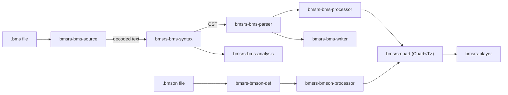

# bmsrs

## Project scope

A Rust workspace for parsing, converting, and simulating playback of BMS
(Be-Music Script) and BMSON chart formats. It produces a unified `Chart<T>`
intermediate representation for renderers and players.

> **Pre-release status**: `0.1.0` has not been released and is under active
> development. All public interfaces may change at any time; semver
> compatibility does not apply. Cross-crate architectural changes and breaking
> API changes only require confirmation from the user.

## Pipeline



## Crate responsibility matrix

| Crate | Role | Input to output |
|-------|------|-----------------|
| `bmsrs-bms-source` | BMS source-text layer: bytes, encoding, line index, byte-faithful editing | `Vec<u8>` to `Document` |
| `bmsrs-bms-syntax` | BMS syntax layer: rowan CST, lexing, error-tolerant parsing, control-flow queries | `&str` to `SourceFile` |
| `bmsrs-bms-values` | BMS single-line syntax and typed values: headers/messages, indices, parsing | `&str` (one line) to typed values |
| `bmsrs-bms-parser` | BMS semantic layer: CST to `Bms` model | CST to `Bms` |
| `bmsrs-bms-values-derive` | `#[derive(BmsTokenAttr)]` proc-macro | no runtime logic |
| `bmsrs-bms-processor` | `Bms` to format-agnostic `Chart` | `Bms` to `Chart` |
| `bmsrs-bms-writer` | BMS generator: rewrites the full `Bms` model as BMS text | `Bms` to `String` |
| `bmsrs-bms-analysis` | BMS analysis layer: diagnostics, symbol index, editor data | `&str` to `Analysis` |
| `bmsrs-bmson-def` | bmson JSON type definitions (v0/v1/v2) | data model only |
| `bmsrs-bmson-processor` | `Bmson` to `Chart` | `Bmson` to `Chart` |
| `bmsrs-chart` | Format-agnostic chart data model | `Chart<T>` as the central IR |
| `bmsrs-player` | Pure simulation layer for `Chart<T>` | timeline queries, no I/O or rendering |
| `bmsrs` | Public re-export facade | aggregated `pub use` |

`bms-lsp` lives in a separate repository: <https://github.com/brightmeows/bms-lsp>.
It depends on this repository's `bmsrs-bms-analysis` and `bmsrs-bms-syntax`
through a git
`rev` and is no longer built as part of this workspace.

External dependencies are managed through `[workspace.dependencies]`; do not
specify versions in individual crate `Cargo.toml` files.

### Facade crate

The repository root is the `bmsrs` facade crate. When adding a workspace crate,
add the corresponding `pub mod` and `pub use` in `src/lib.rs`.

## Commands

### Automatic checks before commit (pre-commit hooks)

```bash
pre-commit run --all-files          # run every hook manually
```

Hooks are configured in `.pre-commit-config.yaml`:

| Hook | Purpose | Failure means |
|------|---------|---------------|
| `cargo fmt --check` | formatting is not canonical | run `cargo fmt` |
| `cargo clippy --workspace --all-targets -- -D warnings` | lint failure | fix the warnings |
| `RUSTDOCFLAGS="-D warnings" cargo doc --workspace --no-deps` | API doc warning | fix the doc issue |
| `no-comment-decorations` | decorative comment blocks | remove decorations such as `// ===` and `// ---` |
| `no-confusable-unicode` | confusable Unicode characters | replace them with ASCII equivalents |
| `no-module-level-expect-allow` | module-level `#![expect]/#[allow]` | use function-level `#[expect(..., reason = "...")]` |

### Manual

```bash
cargo test --workspace --quiet        # workspace tests
cargo bench -p bmsrs-player          # hot-path performance benchmarks
cargo deny check                       # dependency audit (CI)
```

## Conventions

### Commit format

Conventional Commits, matching the `release-plz.toml` changelog groups.
Titles and bodies are written in English. This is a repository-level override
of the global convention, which uses Chinese commit subjects.
Mark breaking changes with `!` before the colon.

### Worktree directory

Git worktrees live under `.worktrees/`.

### MSRV and Edition

| Item | Value |
|------|-------|
| MSRV | 1.95 |
| Edition | 2024 (`resolver = "3"`) |

### Lint conventions

- The workspace uses a shared `[lints]` configuration: `allow_attributes = "deny"`
- `#[allow]` is **forbidden**; always use `#[expect(clippy::lint, reason = "...")]`
- clippy `all` and `pedantic` are enabled by default

### API design

Public operations are exposed as associated functions on types (structs or
zero-sized `*Builder` types); free functions are **forbidden** as public API.
Exceptions: the facade's whole-pipeline entry points (`bms::from_text` /
`bms::from_bytes`) and low-level pure functions (`bmsrs-bms-source` line and
encoding helpers) may remain free functions. They have no domain type to attach
to, and wrapping them in a builder only adds call-site cost.
Use a `*Builder` only when the API has configurable parameters; use plain struct
methods when there is no state.
Private operations **should** follow the same pattern (attached to types rather
than free functions), especially when several functions share the same parameter
set or belong to the same conversion process. This is a recommendation, not a
requirement: pure helpers and simple stateless utilities may remain free
functions.

### Development skills

The project references the following skills during development (personal
configuration, not part of the repository):

| Skill | Source repository | Purpose |
|-------|-------------------|---------|
| `bms` / `bmson` | <https://github.com/brightmeows/bms-skills> | BMS/bmson format specifications and domain terminology |
| `rust-meta-cognition` | <https://github.com/brightmeows/rust-meta-skills> | routing for Rust design and compilation problems |

When citing their content, link to the original sources the skills point to,
not to the skill documents themselves.

### Comment style

- Public items use `///`; modules use `//!` (enforced by clippy)
- `//` is for implementation notes, not documentation
- Doc comments (`///`, `//!`) and implementation comments (`//`) are written in
  English; BMS/bmson domain terms follow the original wording in the bms/bmson
  skills, and code identifiers stay in backticks
- Standard rustdoc section headings (`# Errors`, `# Panics`, `# Examples`, etc.)
  remain in English

### Test conventions

| Aspect | Rule |
|--------|------|
| Naming | `<scenario>_<expectation>`, e.g. `empty_input_returns_empty_bms` |
| Assertions | one test per scenario, possibly with multiple related assertions; the test name states the scenario and the expectation |
| Public API tests | live in `tests/*.rs` (integration tests); **do not** test public API inside `src/` |
| `pub(crate)` and private tests | live in `#[cfg(test)] mod` blocks inside `src/*.rs` |
| Prefer public types | avoid testing internal `Wrap` structs |
| Avoid duplication | before adding a test, check the crate's `tests/` and the `#[cfg(test)] mod` blocks in `src/`; add a new test only when existing tests cannot cover the scenario |

### Known limitations

These are boundaries intentionally left unimplemented or not yet closed.
Reassess them before adding support; do not assume silently.

| Item | Status | Reassess when |
|------|--------|---------------|
| `#EXRANKxx` lookup | `BmsGameplay.ex_rank_defs` keeps the raw definitions; `JudgeOverride` still passes the base36 value through directly | the overall judging system design is finalized |
| `#SWBGA` details | `BgaKeyBound` carries only the resource id; pattern, key, and duration are not modeled | a renderer needs key-bound animations |
| Display fields such as `#CHARFILE` | not included in `Chart` | a renderer needs character images |
| `#CDDA` / `#MIDIFILE` | only stored in the `BmsAudio` sidecar; no playback abstraction | a player needs CD or MIDI sources |
| BMSON `resolution: 0` | rejects the whole file, stricter than the specification | compatibility with authoring-tool defects is required |
| BMS `#BPM 0` | returns `ZeroBpm` instead of falling back to 130 | charts with no scrolling need to be supported |
| BMS `#PLAYER` | ignored; `Bme` covers 5K/7K/10K/14K | automatic family selection by `#PLAYER` is needed |
| BGM layering | BGM events stay separate; only judgeable notes merge `NoteAudio` | a real chart needs BGM layers merged |
| Scope of processor semantic warnings | no `TextRange`; the editor path recomputes them with `bmsrs-bms-analysis` | the LSP needs semantic warnings located in the source text |

### Versioning

- release-plz CI manages versions, CHANGELOG.md, and git tags
- Do **not** manually edit version numbers, create changelogs, or create tags

## Always / Ask / Never

### Always

- Run `pre-commit run --all-files` after changes (or let the hooks run automatically)
- Commit messages follow Conventional Commits with a scope; titles and bodies are written in English
- Each commit contains exactly one logical change; do not mix `feat:` and `fix:` in the same commit
- Doc comments (`///`, `//!`) and implementation comments (`//`) are written in English; code identifiers stay in backticks
- When adding a crate, add the corresponding `pub use` and entry in `src/lib.rs` and the root AGENTS.md

### Ask

- Adding an external dependency that is not part of the workspace
- Modifying `.pre-commit-config.yaml` or CI configuration
- Cross-crate architectural refactors (moving modules, renaming public types)

### Never

- Manually edit version numbers in `Cargo.toml`
- Create or modify CHANGELOG.md
- Force push to the `main` branch
- Add serialization dependencies such as `serde` / `serde_json` to `bmsrs-chart` or `bmsrs-player`
