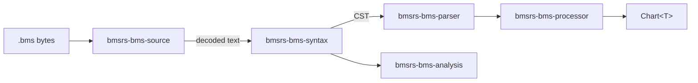

# bms/: BMS format parsing pipeline

## Role

Pipeline for parsing the BMS (Be-Music Script) format. Raw `.bms` bytes pass
through the document layer and a four-stage parsing pipeline into a
format-agnostic `Chart<T>`.

## Pipeline



| Stage | Crate | Responsibility |
|-------|-------|----------------|
| 0 source text | `bmsrs-bms-source` | raw bytes to encoding, lines, trivia, and editing; no semantic classification |
| 1 values | `bmsrs-bms-values` | single-line text to typed headers/messages, indices, and values |
| 2 syntax | `bmsrs-bms-syntax` | decoded text to rowan CST; lexing, error-tolerant parsing, control-flow queries |
| 3 semantics | `bmsrs-bms-parser` | CST to `Bms`; aggregate and faithful model |
| derivation | `bmsrs-bms-values-derive` | `#[derive(BmsTokenAttr)]` proc-macro, no runtime logic |
| 4 conversion | `bmsrs-bms-processor` | `Bms` to `Chart` |
| 5 analysis | `bmsrs-bms-analysis` | diagnostics, symbol index, and editor data |

## Design principles

| Principle | Meaning |
|-----------|---------|
| Layers do not cross boundaries | values does no whole-file work, syntax does no semantic values, parser does no control-flow expansion, processor introduces no I/O |
| Exactly one whole-file loop | line splitting, the comment state machine, encoding, and line endings all live in `bmsrs-bms-source`; the CST processes only decoded text |
| Value types are owned | single-line entry points do not borrow input; string fields uniformly use `String`, so cross-layer passing needs no lifetime parameters |
| Mode families decoupled | key mapping is implemented through zero-sized types implementing the `BmsLayout` trait; mode information is not stored in `Chart` |

## Responsibility criteria

Core principle: **`Bms` is a faithful mapping**. `Bms` fields are a direct
structured representation of BMS file content and do not store derived values
that require computation or semantic interpretation.

| Layer | Does | Criterion |
|-------|------|-----------|
| tokenizer | syntax, single-line value interpretation, local reference validation | can be done within one line |
| parser | cross-command processing required for `Bms` fidelity | without it, the file cannot be faithfully reconstructed |
| processor | lossy `Bms` to `Chart` conversion | involves merging, reference resolution, or table lookup |

**Tokenizer local reference validation** has three levels: id format (character
set and length, already covered by `BmsIndex::FromStr`), id range (some command
ids must fall in specific segments), and multi-field local consistency
(relationships between fields within one command).

**Parser cross-command boundary**:

- Required for fidelity: merging multiple lines with the same measure and
  channel, `#BASE` pre-scanning, index normalization.
- Conversion concerns: `#BGA`/`#BMP` priority, reference resolution, and def
  table lookup belong to the processor.

**Derived values are forbidden**: `Bms` fields must be able to reconstruct the
original BMS file through a roundtrip. If a field value is computed from other
fields or obtained through semantic interpretation (such as `damage = base36 /
2`), store the raw literal value instead and move the derivation to the
processor.

## Tests

```bash
cargo test -p bmsrs-bms-source
cargo test -p bmsrs-bms-values
cargo test -p bmsrs-bms-syntax
cargo test -p bmsrs-bms-parser
cargo test -p bmsrs-bms-processor
cargo test -p bmsrs-bms-analysis
# bmsrs-bms-values-derive is tested indirectly through bmsrs-bms-values roundtrips.
```

## Domain constraints

### Never

- Add `serde` or serialization dependencies to BMS pipeline crates;
  serialization belongs to the bmson domain.
