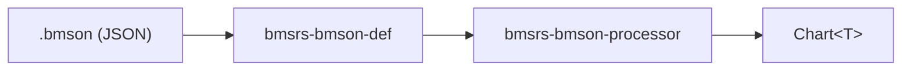

# bmson/: BMSON format parsing pipeline

## Role

Pipeline for parsing BMSON (the JSON serialization of BMS). `.bmson` JSON goes
through parsing, type definitions, and conversion to produce a format-agnostic
`Chart<T>`.

Core design idea: the player slices audio at runtime, so chart authors do not
need to pre-cut sound effects.

## Pipeline



| Stage | Crate | Responsibility |
|-------|-------|----------------|
| Type definition and deserialization | `bmsrs-bmson-def` | pure BMSON data model (v0/v1/v2) with serde deserialization |
| Conversion | `bmsrs-bmson-processor` | `Bmson` (v2) to `Chart` |

## Version model

bmson has three schema versions: v0.21, v1.0, and v2.0. v2 is the root schema;
v0/v1 must first be upgraded to v2 through `Bmson::from` / `TryFrom` before the
processor can handle them.

## Design principles

| Principle | Meaning |
|-----------|---------|
| Type definition and parsing combined | `bmsrs-bmson-def` supports JSON deserialization directly through `serde`, with no separate parsing layer |
| Mode families decoupled | `BmsonLayout` zero-sized types decouple key mapping; `mode_hint` decides dispatch |
| Audio pre-slicing | `SoundChannel` is pre-sliced at startup into an array of `AudioAsset`s, looked up by index at runtime |

## Tests

```bash
cargo test -p bmsrs-bmson-def
cargo test -p bmsrs-bmson-processor
```

## Example

```bash
cargo run --example bmson_parser -p bmsrs-bmson-def
```
