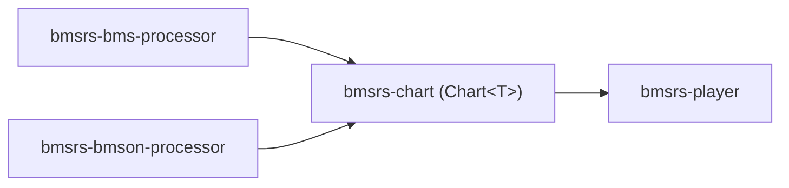

# common/: format-agnostic shared layer

## Role

Format-agnostic chart data model and simulation layer. The BMS and BMSON
pipelines converge here; both processors output `Chart<T>`.

**Zero external dependencies.** Pure `std`, with no `serde`, `thiserror`, or
`serde_json`.

## Architecture



| Crate | Responsibility |
|-------|----------------|
| `bmsrs-chart` | `Chart<T>` central IR: format-agnostic model of events, timing, and notes |
| `bmsrs-player` | pure simulation layer for `Chart<T>`: time-based query interface |

## Time model

| Domain | Type | Use |
|--------|------|-----|
| Tick | `u64` | all event positions, stop durations, LN durations |
| Time | `Duration` | `AudioAsset.start`, `Chart::duration()`, player public API |

`TimingTrack` (precomputed segments, O(log n) queries) bridges the two domains;
`BpmLookup` serves lightweight BPM queries before constructing a `TimingTrack`.
Both live in `bmsrs-chart`.

## Design principles

| Principle | Meaning |
|-----------|---------|
| Zero external dependencies | pure `std`; serialization and error libraries are brought in by upstream crates |
| No side effects | no I/O, rendering, judging, or scoring; pure data and queries |
| Do not store mode information | `Chart` does not store a mode family; notes already carry `(NoteSide, Lane)` |

## Cross-format exemptions

These are deliberate non-unifications. The reassessment point is the arrival of
the corresponding use case from a third format; do not merge them casually
before then.

| Decision | Reason |
|----------|--------|
| `BmsLayout` and `BmsonLayout` are not unified into one trait | their input dimensions differ fundamentally: BMS takes a validated `(player, lane)` pair, BMSON takes one-dimensional `x`; the formats evolve independently, and unifying only adds a generic indirection layer |
| The two `ProcessError` types are defined separately | they share only `TimingTrackError` (forwarded through `#[from]`); BMSON also has `InvalidKeyCount`, and merging would drag format-specific errors into a shared type |
| `TimingTrack` forward and inverse segments accumulate time separately | two implementations of the same mathematical transform (`new` and `merge_inv`); if a third kind of timing distortion appears (such as gradual BPM), reassess before writing a third copy |

## Tests

```bash
cargo test -p bmsrs-chart
cargo test -p bmsrs-player
cargo bench -p bmsrs-player          # hot-path performance benchmarks
```
